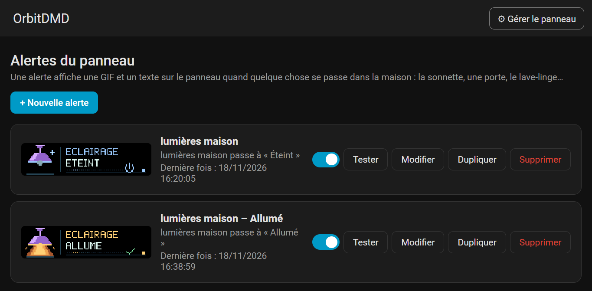
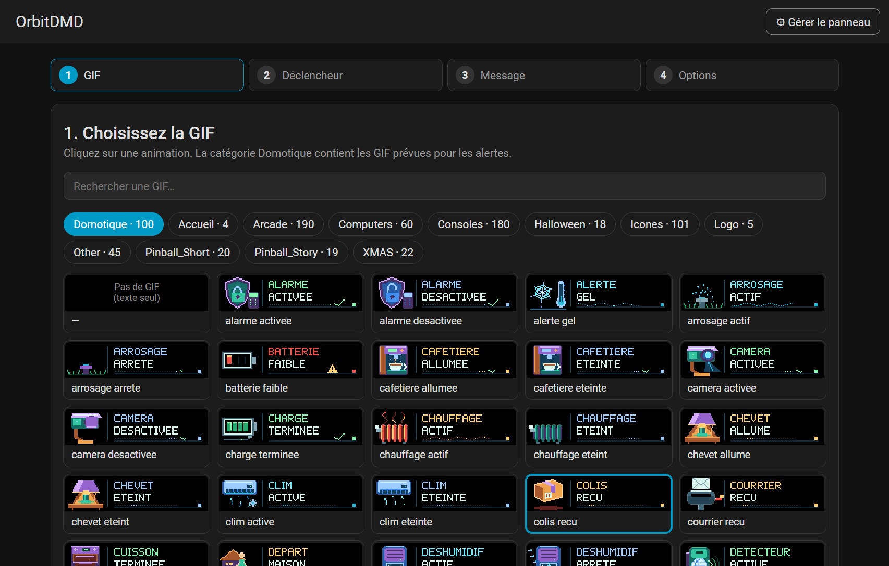
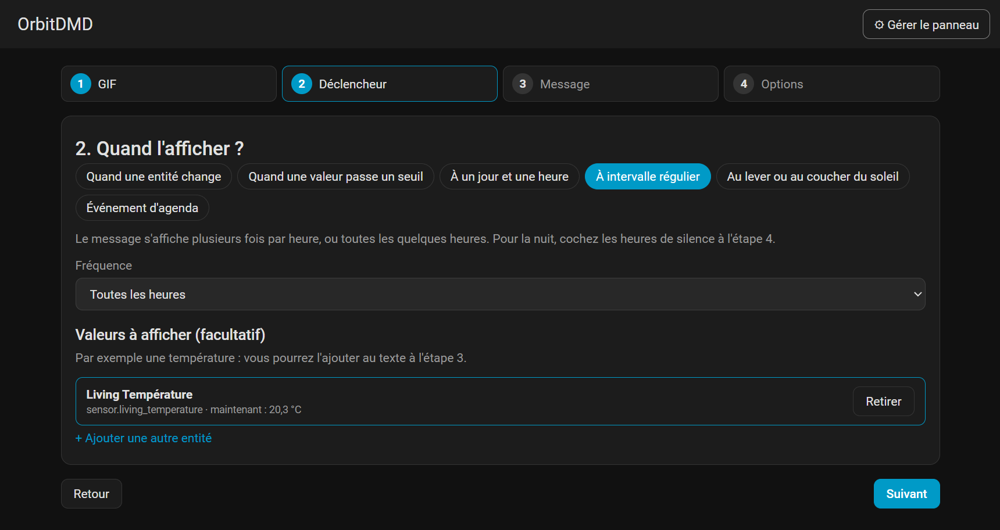
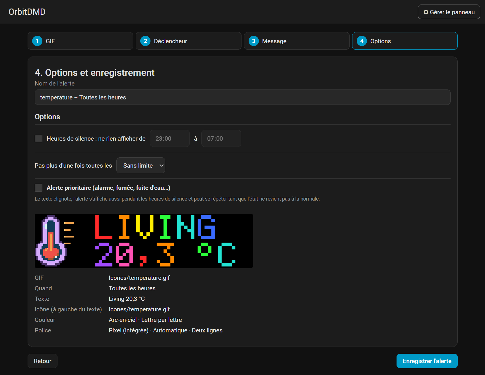

# OrbitDMD pour Home Assistant

Intégration Home Assistant pour les panneaux LED [OrbitDMD](https://github.com/ulrikadam/OrbitDMD)
(Raspberry Pi 3 + panneaux HUB75). Elle parle directement à la page web du panneau :
**pas besoin de MQTT ni de YAML**.

*[English below](#english).*

  
  

  
  

  

## Ce qu'elle apporte

- **Détection automatique** : le panneau apparaît tout seul dans *Paramètres → Appareils et services*
  (« Nouvel appareil découvert ») ; il suffit d'indiquer le mot de passe de sa page web.
- **Page OrbitDMD** dans la barre latérale : un assistant en 4 étapes crée les **alertes**
  1. choisir une **GIF** parmi les vignettes animées du panneau (catégorie Domotique en premier) ;
  2. choisir **quand** : quand une entité change (sonnette, portes, fenêtres…), quand une valeur passe un
     seuil (gel, batterie faible…), à un jour et une heure (poubelles, une semaine sur deux possible),
     **à intervalle régulier** (toutes les heures, 4 fois par heure…), au lever ou au coucher du soleil,
     ou à un événement d'agenda ; avec « pendant au moins X minutes » si besoin ;
  3. écrire le **texte** (avec la valeur d'un capteur, arrondie : « 21,5 °C »), couleur, effet, vitesse,
     passages, **police**, **taille**, **une ou deux lignes**, et l'affichage : la GIF complète puis le texte,
     ou **l'icône de la GIF à gauche et le texte à côté** ; un **aperçu animé** montre le texte comme sur le
     panneau (même police, même découpage), et le bouton **Tester sur le panneau** l'envoie pour de vrai ;
  4. **options** : heures de silence, pas plus d'une fois toutes les X minutes, **alerte prioritaire**
     (texte clignotant, affichée même la nuit, répétée tant que l'état ne revient pas à la normale).

  Chaque alerte est une automatisation ordinaire de Home Assistant, rangée dans la catégorie « OrbitDMD ».
  Boutons Tester, Modifier, Dupliquer (pratique pour les paires allumé / éteint) et Supprimer ;
  bouton **Gérer le panneau** pour ouvrir sa page web.
- **Menu Alexa** (avec l'intégration communautaire [Alexa Media Player](https://github.com/alandtse/alexa_media_player)) :
  cochez vos appareils Alexa et ce qu'il faut afficher, les alertes sont créées toutes seules :
  - les **minuteurs** (lancé, temps restant toutes les X minutes, terminé, annulé), les **rappels**, les
    **alarmes** et la **musique** qui passe ;
  - la **commande vocale** : chaque phrase dite à Alexa s'affiche comme des sous-titres, avec sa réponse si
    vous voulez, sauf les phrases à ignorer (« stop », « chut »…) ;
  - la **dictée** : « Alexa, affiche bonjour tout le monde » → « Bonjour tout le monde » sur le panneau.

  Chaque événement a les mêmes réglages qu'une alerte (texte, couleur, effet, police, taille, lignes, icône,
  aperçu, bouton Tester) et se replie pour garder le menu court. Avec le programme **1.8.0** du panneau, des
  icônes dédiées (sablier, réveil, rappel, musique…) sont choisies ; avant, des icônes proches.
- **Le panneau comme une lumière** : allumer, éteindre (la page web reste joignable), luminosité.
- **Interrupteurs** : pause (image figée), luminosité heure par heure.
- **Boutons** : afficher l'heure, afficher la météo, redémarrer.
- **Capteurs** : GIF affichée, écran, température du processeur, adresse IP, version.
- **Action** `orbitdmd.notify` (texte, GIF, icône, effet, couleur, police, taille, lignes, vitesse, passages,
  clignotement), action d'appareil
  « Afficher une notification » avec la liste des GIF, et entité de notification (`notify.send_message`).
- **12 langues** : français, anglais, néerlandais, espagnol, russe, allemand, italien, portugais, polonais,
  ukrainien, turc et tchèque (la langue de votre profil Home Assistant).
- **Réparations** : un message apparaît si le programme du panneau est trop ancien.
- **Diagnostics** téléchargeables (mot de passe et nom du Wi-Fi masqués).

## Ce qu'il faut

- Un panneau OrbitDMD avec le programme **1.6.0 ou plus récent**, **1.7.0** pour l'icône + texte, les deux
  lignes et la vraie police dans l'aperçu
  ([dernière version](https://github.com/ulrikadam/OrbitDMD/releases/latest) ; à installer depuis la page web
  du panneau : Système → Nouveau programme).
- Home Assistant **2025.1** ou plus récent (le logo de l'intégration s'affiche à partir de 2026.3).
- Pour le menu Alexa : **Alexa Media Player**, installé avec HACS et relié à votre compte Amazon.

## Installation

### Avec HACS (conseillé)
OrbitDMD est dans la **boutique officielle de HACS**.
1. Ouvrez **HACS**, cherchez **OrbitDMD** (ou cliquez sur le bouton « Ouvrir dans HACS » en haut de cette page).
2. Cliquez sur **Télécharger**, puis redémarrez Home Assistant.
3. Le panneau apparaît dans **Paramètres → Appareils et services** (« Découvert ») : cliquez sur **Ajouter**
   et indiquez le mot de passe de sa page web. Sinon : **Ajouter une intégration → OrbitDMD**, adresse du
   panneau (par exemple `orbitdmd.local` ou son adresse IP) et mot de passe.

Si OrbitDMD n'apparaît pas encore dans la recherche : HACS → menu ⋮ → **Dépôts personnalisés** →
`https://github.com/ulrikadam/OrbitDMD-HomeAssistant`, type **Intégration**, puis suivez les mêmes étapes.

### À la main
Copiez le dossier `custom_components/orbitdmd` dans le dossier `config/custom_components/` de
Home Assistant, redémarrez, puis ajoutez l'intégration.

## MQTT ou intégration ?

Le panneau sait aussi se relier à Home Assistant par MQTT
([guide](https://github.com/ulrikadam/OrbitDMD/blob/main/docs/HOME-ASSISTANT.md)). Utilisez l'un **ou**
l'autre : avec les deux, le panneau apparaît deux fois. Pour passer de MQTT à l'intégration, désactivez
Home Assistant dans la page web du panneau (Réglages → Home Assistant), puis supprimez l'appareil OrbitDMD
de l'intégration MQTT.

## Bon à savoir

- La page OrbitDMD et le bouton « Gérer le panneau » ont besoin d'être sur le même réseau que le panneau.
- Un nouveau panneau peut mettre jusqu'à 2 minutes à être découvert (il s'annonce toutes les 110 secondes environ).
- Un modèle d'automatisation (blueprint) est aussi fourni : `blueprints/automation/orbitdmd/notification.yaml`.
- Alexa : les informations passent par les serveurs d'Amazon. Une phrase arrive sur le panneau 2 à 10 secondes
  après ; pour la dictée, Alexa répond parfois qu'elle ne comprend pas, c'est normal. Alexa Media Player n'est
  pas officiel : un changement chez Amazon peut le bloquer quelques jours, le temps d'une mise à jour.

Licence : MIT.

---

## English

Home Assistant integration for [OrbitDMD](https://github.com/ulrikadam/OrbitDMD) LED panels (Raspberry Pi 3 +
HUB75 panels). It talks directly to the panel's web page: **no MQTT, no YAML**.

- **Automatic discovery**: the panel shows up in *Settings → Devices & services*; you only enter the password
  of its web page.
- **OrbitDMD page** in the sidebar: a 4-step wizard creates **alerts** — pick a GIF from the panel's animated
  thumbnails; choose when: an entity changes, a value crosses a threshold, a day and time, **at regular
  intervals** (every hour, 4 times an hour…), sunrise or sunset, or a calendar event; write the text (with a
  rounded sensor value), colour, effect, speed, passes, **font**, **size**, **one or two lines**, and the layout
  (the full GIF then the text, or **the GIF's icon on the left with the text beside it**), with an **animated
  preview** that matches the panel and "Test on the panel"; then options: quiet hours, cooldown and
  **priority alerts** (blinking text, shown even at night, repeated until the state goes back to normal).
  Each alert is a regular Home Assistant automation in the "OrbitDMD" category; Test, Edit, Duplicate and Delete
  buttons, plus **Manage the panel** to open its web page.
- **Alexa menu** (with the community integration [Alexa Media Player](https://github.com/alandtse/alexa_media_player)):
  tick your Alexa devices and what to show, and the alerts are created for you: **timers** (started, time left
  every X minutes, done, cancelled), **reminders**, **alarms**, the **music** playing, **voice commands** (every
  sentence said to Alexa as subtitles, optionally with her answer, except sentences you choose to skip) and
  **dictation** ("Alexa, display hello everyone" → "Hello everyone" on the panel). Each event has the same
  display settings as an alert and folds away to keep the menu short. With panel program **1.8.0**, dedicated
  icons (hourglass, alarm clock, reminder, music…) are used; before that, similar icons. Sentences reach the
  panel 2 to 10 seconds later, through Amazon's servers.
- The panel as a **light** (on/off, brightness), pause and hourly-brightness **switches**, show time / show
  weather / restart **buttons**, **sensors** (current GIF, screen, CPU temperature, IP, version).
- `orbitdmd.notify` **action**, "Show a notification" device action with the GIF list, and a notify entity.
- **12 languages**, **repairs** issue when the panel program is too old, downloadable **diagnostics**
  (password and Wi-Fi name redacted).

**Requirements**: OrbitDMD panel program **1.6.0 or later** (**1.7.0** for icon + text, two lines and the real
font in the preview), Home Assistant **2025.1 or later** (logo from 2026.3); for the Alexa menu, **Alexa Media
Player** installed with HACS and linked to your Amazon account.

**Install**: OrbitDMD is in the **default HACS store**: open HACS, search for **OrbitDMD** (or use the "Open in
HACS" button above), download it and restart Home Assistant; the panel is then discovered automatically (or *Add
integration → OrbitDMD*). If it does not show up in the search yet: HACS → ⋮ → Custom repositories →
`https://github.com/ulrikadam/OrbitDMD-HomeAssistant` (type Integration). Manual install: copy
`custom_components/orbitdmd` into `config/custom_components/`.

Use either this integration **or** the panel's MQTT connection, not both (the panel would appear twice).

License: MIT.
