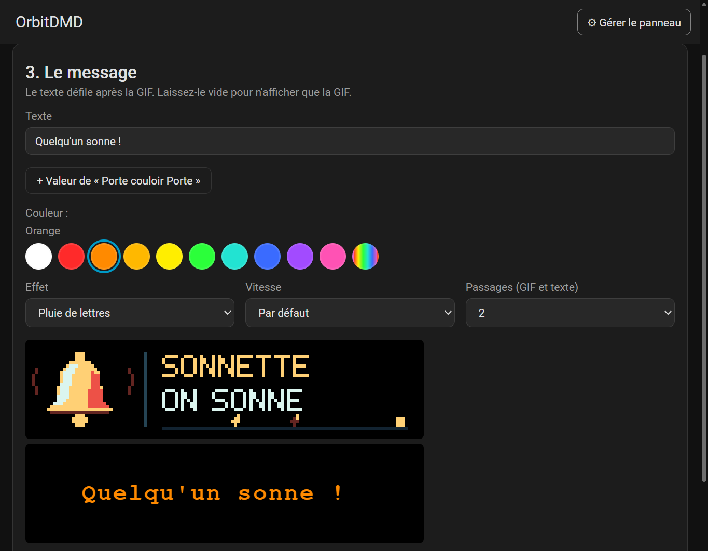

# OrbitDMD pour Home Assistant

Intégration Home Assistant pour les panneaux LED [OrbitDMD](https://github.com/ulrikadam/OrbitDMD)
(Raspberry Pi 3 + panneaux HUB75). Elle parle directement à la page web du panneau :
**pas besoin de MQTT ni de YAML**.

*[English below](#english).*

  
  

  
  

## Ce qu'elle apporte

- **Détection automatique** : le panneau apparaît tout seul dans *Paramètres → Appareils et services*
  (« Nouvel appareil découvert ») ; il suffit d'indiquer le mot de passe de sa page web.
- **Page OrbitDMD** dans la barre latérale : un assistant en 4 étapes crée les **alertes**
  1. choisir une **GIF** parmi les vignettes animées du panneau (catégorie Domotique en premier) ;
  2. choisir **quand** : une ou plusieurs entités (sonnette, portes, fenêtres…) et l'état qui compte ;
  3. écrire le **texte** (avec la valeur d'un capteur, arrondie : « 21,5 °C »), couleur, effet, vitesse,
     passages, avec un aperçu et un bouton **Tester sur le panneau** ;
  4. **options** : heures de silence, pas plus d'une fois toutes les X minutes, **alerte prioritaire**
     (texte clignotant, affichée même la nuit, répétée tant que l'état ne revient pas à la normale).

  Chaque alerte est une automatisation ordinaire de Home Assistant, rangée dans la catégorie « OrbitDMD ».
  Boutons Tester, Modifier, Dupliquer (pratique pour les paires allumé / éteint) et Supprimer ;
  bouton **Gérer le panneau** pour ouvrir sa page web.
- **Le panneau comme une lumière** : allumer, éteindre (la page web reste joignable), luminosité.
- **Interrupteurs** : pause (image figée), luminosité heure par heure.
- **Boutons** : afficher l'heure, afficher la météo, redémarrer.
- **Capteurs** : GIF affichée, écran, température du processeur, adresse IP, version.
- **Action** `orbitdmd.notify` (texte, GIF, effet, couleur, vitesse, passages, clignotement), action d'appareil
  « Afficher une notification » avec la liste des GIF, et entité de notification (`notify.send_message`).
- **12 langues** : français, anglais, néerlandais, espagnol, russe, allemand, italien, portugais, polonais,
  ukrainien, turc et tchèque (la langue de votre profil Home Assistant).
- **Réparations** : un message apparaît si le programme du panneau est trop ancien.
- **Diagnostics** téléchargeables (mot de passe et nom du Wi-Fi masqués).

## Ce qu'il faut

- Un panneau OrbitDMD avec le programme **1.6.0 ou plus récent**
  ([dernière version](https://github.com/ulrikadam/OrbitDMD/releases/latest) ; à installer depuis la page web
  du panneau : Système → Nouveau programme).
- Home Assistant **2025.1** ou plus récent (le logo de l'intégration s'affiche à partir de 2026.3).

## Installation

### Avec HACS (conseillé)
1. HACS → menu ⋮ → **Dépôts personnalisés** → `https://github.com/ulrikadam/OrbitDMD-HomeAssistant`, type **Intégration**.
2. Installez **OrbitDMD**, puis redémarrez Home Assistant.
3. Le panneau apparaît dans **Paramètres → Appareils et services** (« Découvert ») : cliquez sur **Ajouter**
   et indiquez le mot de passe de sa page web. Sinon : **Ajouter une intégration → OrbitDMD**, adresse du
   panneau (par exemple `orbitdmd.local` ou son adresse IP) et mot de passe.

### À la main
Copiez le dossier `custom_components/orbitdmd` dans le dossier `config/custom_components/` de
Home Assistant, redémarrez, puis ajoutez l'intégration.

## MQTT ou intégration ?

Le panneau sait aussi se relier à Home Assistant par MQTT
([guide](https://github.com/ulrikadam/OrbitDMD/blob/main/docs/HOME-ASSISTANT.md)). Utilisez l'un **ou**
l'autre : avec les deux, le panneau apparaît deux fois. Pour passer de MQTT à l'intégration, désactivez
Home Assistant dans la page web du panneau (Réglages → Home Assistant), puis supprimez l'appareil OrbitDMD
de l'intégration MQTT.

## Bon à savoir

- La page OrbitDMD et le bouton « Gérer le panneau » ont besoin d'être sur le même réseau que le panneau.
- Un nouveau panneau peut mettre jusqu'à 2 minutes à être découvert (il s'annonce toutes les 110 secondes environ).
- Un modèle d'automatisation (blueprint) est aussi fourni : `blueprints/automation/orbitdmd/notification.yaml`.

Licence : MIT.

---

## English

Home Assistant integration for [OrbitDMD](https://github.com/ulrikadam/OrbitDMD) LED panels (Raspberry Pi 3 +
HUB75 panels). It talks directly to the panel's web page: **no MQTT, no YAML**.

- **Automatic discovery**: the panel shows up in *Settings → Devices & services*; you only enter the password
  of its web page.
- **OrbitDMD page** in the sidebar: a 4-step wizard creates **alerts** — pick a GIF from the panel's animated
  thumbnails, choose one or more triggering entities and the state, write the text (with a rounded sensor value),
  colour, effect, speed and passes (preview + "Test on the panel"), then options: quiet hours, cooldown and
  **priority alerts** (blinking text, shown even at night, repeated until the state goes back to normal).
  Each alert is a regular Home Assistant automation in the "OrbitDMD" category; Test, Edit, Duplicate and Delete
  buttons, plus **Manage the panel** to open its web page.
- The panel as a **light** (on/off, brightness), pause and hourly-brightness **switches**, show time / show
  weather / restart **buttons**, **sensors** (current GIF, screen, CPU temperature, IP, version).
- `orbitdmd.notify` **action**, "Show a notification" device action with the GIF list, and a notify entity.
- **12 languages**, **repairs** issue when the panel program is too old, downloadable **diagnostics**
  (password and Wi-Fi name redacted).

**Requirements**: OrbitDMD panel program **1.6.0 or later**, Home Assistant **2025.1 or later** (logo from 2026.3).

**Install**: HACS → ⋮ → Custom repositories → `https://github.com/ulrikadam/OrbitDMD-HomeAssistant`
(type Integration), install **OrbitDMD**, restart Home Assistant; the panel is then discovered automatically
(or *Add integration → OrbitDMD*). Manual install: copy `custom_components/orbitdmd` into `config/custom_components/`.

Use either this integration **or** the panel's MQTT connection, not both (the panel would appear twice).

License: MIT.
